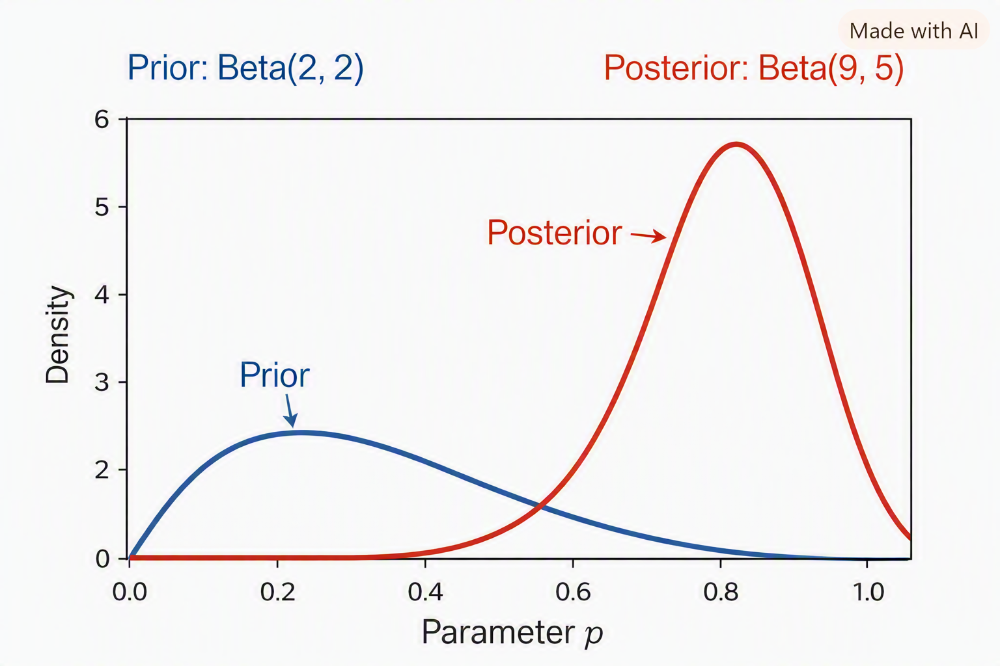

# **Bayesian formulation in statistical modeling**

### 🔹 The Equation
$$
P(\text{Parameters} \mid \text{Data}, \text{Model}) = \frac{P(\text{Data} \mid \text{Model}, \text{Parameters}) \cdot P(\text{Parameters} \mid \text{Model})}{P(\text{Data} \mid \text{Model})}
$$

### 🔹 Meaning of Each Term
- **Posterior**: \(P(\text{Parameters} \mid \text{Data}, \text{Model})\)  
  → What we want: the probability distribution of parameters after seeing the data.

- **Likelihood**: \(P(\text{Data} \mid \text{Model}, \text{Parameters})\)  
  → How probable the observed data is, given the parameters.

- **Prior**: \(P(\text{Parameters} \mid \text{Model})\)  
  → What we believed about the parameters before seeing the data.

- **Evidence (Marginal Likelihood)**: \(P(\text{Data} \mid \text{Model})\)  
  → Normalizing constant ensuring probabilities sum to 1. It’s often hard to compute directly.

### 🔹 Intuition
Bayes’ theorem here says:
- Start with a **prior belief** about parameters.  
- Update it using the **likelihood** of observed data.  
- Normalize with the **evidence** to get the **posterior**.  

This is the backbone of **Bayesian inference** in machine learning, statistics, and AI.

---

💡 **Example (Coin Toss):**
Suppose you’re estimating the bias of a coin:
- Prior: You believe it’s fair (\(p=0.5\)).  
- Likelihood: You toss it 10 times and see 7 heads.  
- Posterior: Bayes updates your belief — now you think the coin is probably biased toward heads.

---

### 🔹 Beta Distribution as a Prior
The Beta distribution is perfect for modeling prior beliefs about a probability \(p\) (like the bias of a coin).

$$
\text{Beta}(\alpha, \beta) \quad \Rightarrow \quad f(p) = \frac{1}{B(\alpha,\beta)} p^{\alpha-1}(1-p)^{\beta-1}
$$

- \(\alpha\) = prior “successes” (heads)  
- \(\beta\) = prior “failures” (tails)  
- Mode (most likely value):  
 $$
  \frac{\alpha - 1}{\alpha + \beta - 2}
  $$

---

### 🎲 Example: Coin Toss with Prior
Suppose:
- Prior belief: coin is fair → \(\alpha = 2, \beta = 2\).  
- Data: 10 tosses, 7 heads, 3 tails.

---

### 🔹 Posterior Distribution
Bayes’ theorem updates the prior with the data. For a Beta prior and Binomial likelihood, the posterior is also Beta:

$$
\text{Posterior} = \text{Beta}(\alpha + \text{heads}, \beta + \text{tails})
$$

$$
= \text{Beta}(2+7, 2+3) = \text{Beta}(9,5)
$$

---

### 🔹 MAP Estimate
MAP is the mode of the posterior:

$$
\hat{\theta}_{MAP} = \frac{\alpha + \text{heads} - 1}{\alpha + \beta + n - 2}
$$

$$
= \frac{2+7-1}{2+2+10-2} = \frac{8}{12} = 0.667
$$

So the MAP estimate is **0.667**.

---

### 🔹 MLE vs MAP vs Full Posterior
- **MLE**: purely data → \(0.7\).  
- **MAP**: balances prior + data → \(0.667\).  
- **Posterior distribution**: not just a single number, but a full curve (Beta(9,5)) showing uncertainty around the estimate.

---

### ✅ Key Insight
The Beta distribution lets us encode prior beliefs. Bayes’ theorem updates those beliefs with data. MAP gives a point estimate, while the full posterior gives a distribution of possible values — richer information about uncertainty.

Here’s the visualization you asked for — the **prior vs posterior Beta distributions** are ready now.  

- The **blue curve (Prior: Beta(2,2))** reflects your initial belief: symmetric around 0.5, meaning you thought the coin was likely fair.  
- The **red curve (Posterior: Beta(9,5))** shows how the data (7 heads, 3 tails) reshaped that belief: the peak shifts toward 0.67, indicating stronger evidence for a bias toward heads.  
- 
---
Good question — understanding **α (alpha)** and **β (beta)** is key to grasping the Beta distribution and Bayesian inference.  

Here’s a clear breakdown:

---

### 🔹 What α and β Represent
In the **Beta distribution**,  
$$
\text{Beta}(\alpha, \beta)
$$
these two parameters shape the curve that represents your belief about a probability \(p\) (for example, the chance of a coin landing heads).

- **α (alpha)** → prior count of “successes” (e.g., heads)  
- **β (beta)** → prior count of “failures” (e.g., tails)

They don’t have to be whole numbers — they’re *pseudo-counts* expressing how confident you are before seeing any data.

---

### 🔹 Intuitive Meaning
| Parameter | Interpretation | Example Shape |
|------------|----------------|----------------|
| α = β = 1 | Uniform (flat) — no prior preference | Equal chance for all \(p\) |
| α > β | Belief that success is more likely | Curve peaks near 1 |
| α < β | Belief that failure is more likely | Curve peaks near 0 |
| α, β both large | Strong prior confidence (narrow curve) | Very peaked around prior mean |

---

### 🔹 Example
If you start with **α = 2, β = 2**, your prior belief is that the coin is roughly fair (mean = 0.5).  
After seeing **7 heads and 3 tails**, your posterior becomes **α = 9, β = 5**, shifting the curve toward 0.67 — meaning you now believe heads are more likely.

---

### 💡 Analogy
Think of α and β as “memory” of past experiences:
- α = how many times you’ve seen success before,
- β = how many times you’ve seen failure before.

Bayes’ theorem updates these counts with new evidence.

---